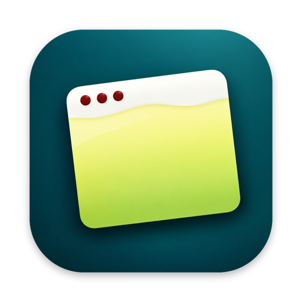

<div align="center">



# Pisco Sour

*Programas y juegos de Windows en tu Mac, sin instalar Windows.*

</div>

## Gracias, Whisky 🥃

**Pisco Sour nace de [Whisky](https://github.com/Whisky-App/Whisky)**, creado por Isaac Marovitz y su comunidad. Sin su trabajo, que es la base de toda esta app, Pisco Sour no existiría. Gran parte del código de este repositorio es suyo, y cada archivo lo conserva en su encabezado.

También damos las gracias a:

- **[Wine](https://www.winehq.org)**, que hace posible ejecutar programas de Windows fuera de Windows.
- **[Gcenx](https://github.com/Gcenx/macOS_Wine_builds)**, por sus versiones de Wine para macOS, que son las que usa Pisco Sour.
- **[ScummVM](https://www.scummvm.org)**, con la que funcionan los juegos clásicos de Windows 3.1.
- **[ICU](https://icu.unicode.org)** (Unicode), por las librerías de texto que necesitan muchos programas modernos.

## Qué hace

- **Instalas un programa de Windows y queda como app de Mac.** Arrastras un `.exe`, un `.msi` o un `.iso` a Pisco Sour, y el programa aparece en Launchpad y en Aplicaciones con su nombre y su icono. Cmd+Q lo cierra como a cualquier app.
- **Sin "botellas" a la vista.** Cada programa vive en su propio entorno de Wine, aislado de los demás. Tú solo ves la lista de programas. Hay una vista avanzada con las botellas para quien la quiera.
- **Discos ISO.** Monta la imagen como si fuera un CD en la unidad D:, busca el instalador (`autorun.inf` o `setup.exe`) y lo ejecuta.
- **Juegos clásicos de Windows 3.1.** En Mac con chip Apple, Wine no puede ejecutar programas de 16 bits. Pisco Sour los detecta y, si es un juego que ScummVM conoce (Sierra, LucasArts y cientos más), lo instala con ScummVM como una app más.

## Descargar

**[⬇ Descargar Pisco Sour (.dmg)](https://github.com/sdelsolar90/pisco-sour/releases/latest/download/PiscoSour.dmg)**

1. Abre el `.dmg` y arrastra **Pisco Sour** a Aplicaciones.
2. La app aún no está notarizada por Apple, así que la primera vez macOS la bloqueará. Ábrela una vez, ve a **Ajustes del Sistema → Privacidad y seguridad** y pulsa **"Abrir igualmente"**.

   Otra forma: abre **Terminal** y pega esta línea (solo hace falta una vez):
   ```sh
   xattr -dr com.apple.quarantine "/Applications/Pisco Sour.app"
   ```
3. Al abrirla, Pisco Sour descarga Wine (unos 185 MB) y ya puedes instalar programas.

## Requisitos

- Mac con chip Apple (serie M).
- macOS Sonoma 14.0 o posterior.

## Compilar

1. Abre `Whisky.xcodeproj` en Xcode.
2. Compila el ScummVM que lleva la app (sin la pantalla de inicio de ScummVM, para que los juegos abran directamente):
   ```sh
   scripts/build-scummvm.sh ~/scummvm-build
   ```
3. Compila el esquema `Whisky`. La app resultante se llama `Pisco Sour.app`.

`scripts/build-icu-forwarders.sh` regenera las librerías ICU de `Whisky/WindowsICU`.

## Licencia

El código de Pisco Sour es software libre bajo la licencia **[GPL-3.0](LICENSE)**, la misma de Whisky. Puedes usarlo, estudiarlo, modificarlo y redistribuirlo. Si distribuyes una versión modificada, tienes que publicar su código fuente bajo la misma licencia.

## Nombre y logo

El nombre **"Pisco Sour"** y su **logo** son de Santiago del Solar y **no forman parte de la licencia GPL**. No se pueden usar para identificar otros productos, ni versiones modificadas o derivadas de esta app, ni con fines comerciales, sin permiso previo por escrito.

Si quieres distribuir tu propia versión, usa otro nombre y otro logo. Para cualquier otro uso, escribe a través de [GitHub](https://github.com/sdelsolar90).

---

*"Whisky" es un proyecto de Isaac Marovitz. Wine, ScummVM y el resto de proyectos mencionados pertenecen a sus respectivos autores.*
